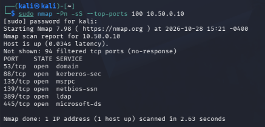
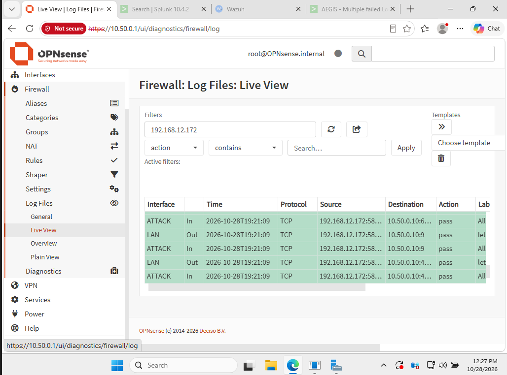
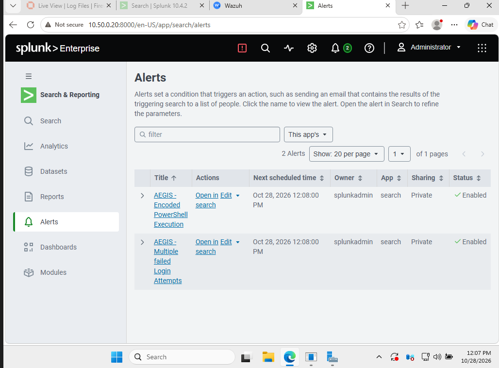
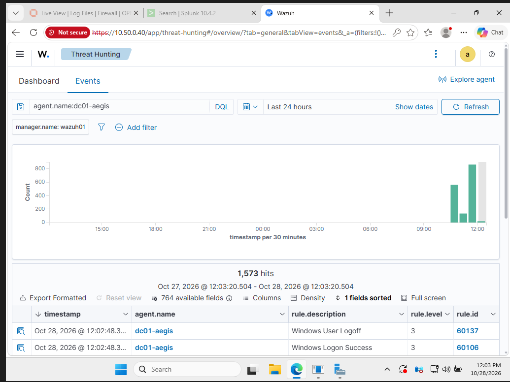

# AEGIS Enterprise Cybersecurity Home Lab

AEGIS is an isolated enterprise cybersecurity home lab built to practice **Active Directory, enterprise networking, SIEM operations, detection engineering, incident response, and controlled Red Team / Blue Team exercises**.

The environment combines a virtual enterprise network with a dedicated physical Kali Linux attacker system.

**Status: AEGIS v1.0 Complete**

---

## Architecture

```text
Physical Kali
192.168.12.172
      |
      v
Windows Virtualization Host
Wi-Fi: 192.168.12.180
      |
      | Persistent IPv4 forwarding
      v
VirtualBox Host-Only
10.60.10.254
      |
      v
OPNsense ATTACK
10.60.10.1
      |
      | Scoped + logged firewall policy
      v
AEGIS-LAN
10.50.0.0/24
      |
      +-- DC01     10.50.0.10
      +-- SOC01    10.50.0.20
      +-- WS01     10.50.0.30
      +-- WAZUH01  10.50.0.40
```

| System | Role |
|---|---|
| OPNsense-FW | Firewall, gateway, Suricata IDS |
| DC01 | Windows Server 2025, Active Directory, DNS, Group Policy |
| SOC01 | Ubuntu Server 24.04 LTS, Splunk Enterprise |
| WS01 | Windows 11 Enterprise, Sysmon endpoint |
| WAZUH01 | Ubuntu Server 24.04 LTS, Wazuh SIEM/XDR |
| Physical Kali | Controlled Red Team system |

---

## Technology Stack

**Enterprise / Windows:** Active Directory, DNS, Group Policy, Windows Security Auditing, Sysmon  
**SIEM / Detection:** Splunk Enterprise 10.4.2, Wazuh 4.14.7, Windows Event Logs  
**Network Security:** OPNsense 26.7.3_11, Suricata IDS, ET Open rules, static routing, segmentation  
**Red Team:** Kali Linux, Nmap, controlled SMB authentication testing, PowerShell execution testing  
**Engineering:** VirtualBox, Git, GitHub, technical documentation

---

## Physical Kali Integration

Persistent routes:

```text
Kali:
10.50.0.0/24 -> 192.168.12.180

Windows Host:
10.50.0.0/24 -> 10.60.10.1

OPNsense:
192.168.12.172/32 -> 10.60.10.254
```

OPNsense restricts the attacker path with a logged rule:

```text
Source:      KALI_ATTACKER
Destination: AEGIS_TARGETS
Action:      Pass
Logging:     Enabled
```

The route was validated after system and VM restarts.

---

## Detection Validation

### Failed Authentication

Physical Kali generated controlled SMB authentication failures against DC01 using nonexistent test usernames.

DC01 recorded Windows Event ID `4625` with Logon Type `3`, Workstation `KALI`, source `192.168.12.172`, and NTLM authentication failures.

Splunk detection:

```text
AEGIS - Multiple failed Login Attempts
```

### Encoded PowerShell

A harmless encoded PowerShell command was executed on WS01.

Windows Security generated Event ID `4688`, and Splunk detection logic identified the `-EncodedCommand` argument.

Saved detection:

```text
AEGIS - Encoded PowerShell Execution
```

### Network IDS

Suricata is deployed inside OPNsense in IDS / alert-only mode with Emerging Threats Open rules.

A controlled validation previously triggered:

```text
SID 2100498
GPL ATTACK_RESPONSE id check returned root
```

---

## Validation Evidence

### Kali Reconnaissance



### OPNsense Firewall Logging



### Splunk Detection Configuration



### Wazuh DC01 Telemetry



---

## Incident Response

Primary report:

```text
Incident-Reports/IR-001-Multiple-Failed-Logins.md
```

Classification:

```text
True Positive - Authorized Security Test
```

---

## Repository Structure

```text
AEGIS-Cyber-Range/
├── Configs/
├── Detection-Rules/
├── Documentation/
├── Incident-Reports/
├── Screenshots/
├── Scripts/
├── .gitignore
└── README.md
```

---

## Skills Demonstrated

- Active Directory administration
- Windows security auditing
- enterprise networking
- static routing and IP forwarding
- firewall policy and segmentation
- Splunk SIEM
- Wazuh SIEM/XDR
- Sysmon
- Suricata IDS
- detection engineering
- incident response
- Kali Linux and Nmap
- Git / GitHub
- technical documentation

---

## Final Status

```text
Active Directory              COMPLETE
DNS / Group Policy            COMPLETE
Windows Endpoint              COMPLETE
Physical Kali Integration     COMPLETE
Persistent Routing            COMPLETE
OPNsense Firewall             COMPLETE
Splunk SIEM                   COMPLETE
Wazuh SIEM/XDR                COMPLETE
Suricata IDS                  COMPLETE
Failed Login Detection        COMPLETE
Encoded PowerShell Detection  COMPLETE
Incident Response             COMPLETE
Final VM Snapshots            COMPLETE
GitHub Documentation          COMPLETE
```

## AEGIS v1.0 — Complete

All offensive-security testing in this project is restricted to systems owned and intentionally configured for the isolated AEGIS cyber range.

Future enhancements will be developed separately as **AEGIS v2**.
