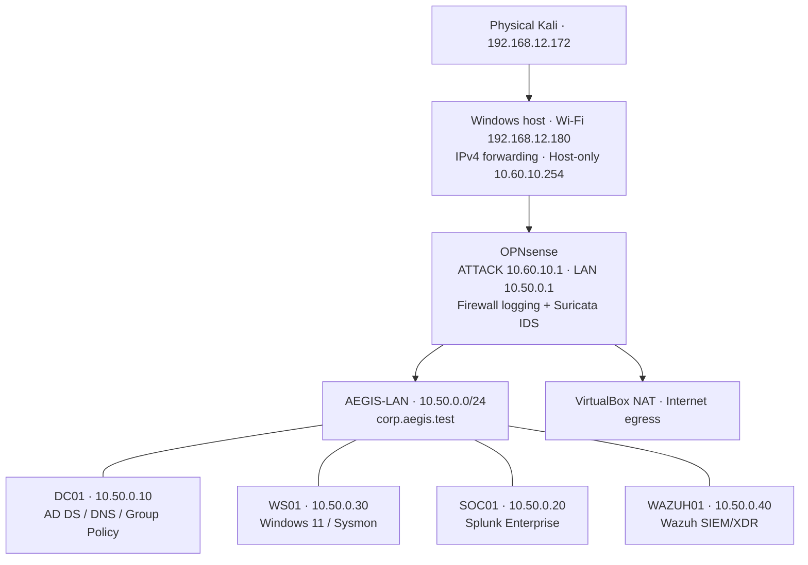
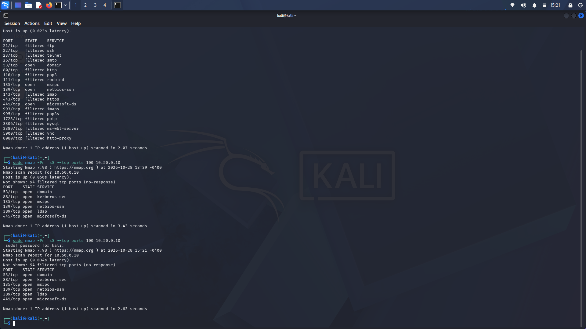

# AEGIS Enterprise Cybersecurity Home Lab

**AEGIS v1.0 — Complete** · Enterprise networking · Detection engineering · Incident response

AEGIS is a personal cyber range connecting a physical Kali Linux laptop to a segmented VirtualBox enterprise network. It combines Active Directory, Windows auditing, Splunk, Wazuh, and Suricata to practice the workflow from controlled test activity to investigation and incident reporting.

The main networking challenge was making the physical Kali path persistent across restarts while keeping OPNsense in the traffic path and preserving Kali's source IP in firewall and endpoint logs.

## Start here

- [Architecture and trust boundaries](Documentation/architecture.md)
- [Addressing and routes](Documentation/network-plan.txt)
- [Validation results and evidence limits](Documentation/validation.md)
- [IR-001: failed Active Directory logons](Incident-Reports/IR-001-Multiple-Failed-Logins.md)
- [Screenshot gallery](Screenshots/README.md)

## Architecture

ATTACK is a separate host-only transit subnet, `10.60.10.0/24`. Windows routes traffic rather than bridging Kali into AEGIS-LAN. Enterprise VMs share one internal subnet; v1 does not provide segmentation between individual enterprise hosts.

## What was built

| Component | Role in AEGIS v1 |
|---|---|
| Windows Server 2025 / DC01 | Active Directory, DNS, Group Policy, Security event auditing |
| Windows 11 Enterprise / WS01 | Domain workstation, Sysmon, process creation telemetry |
| Ubuntu Server 24.04 LTS / SOC01 | Splunk Enterprise 10.4.2, Windows log ingestion, saved detections |
| Ubuntu Server 24.04 LTS / WAZUH01 | Wazuh 4.14.7, endpoint telemetry and vulnerability events |
| OPNsense 26.7.3_11 | Routing, scoped ATTACK policy, firewall logs, Suricata with ET Open |
| Physical Kali Linux | Authorized reconnaissance and controlled authentication testing |

These versions describe the recorded build baseline. On the 32 GB host, Splunk and Wazuh normally run in separate [workload profiles](Documentation/vm-resource-plan.md).

## Validation outcomes

| Exercise | Recorded result | Published evidence |
|---|---|---|
| Kali reconnaissance | DC01 reachable; TCP 53, 88, 135, 139, 389, 445 open | Original uploaded [Nmap image](Screenshots/02-kali-nmap-dc01.png) |
| ATTACK routing | Kali source retained; ATTACK ingress and LAN egress logged | [OPNsense pass traffic](Screenshots/03-opnsense-attack-traffic.png) |
| Failed SMB authentication | Historical record: Event 4625, six test failures, Splunk detection, Wazuh rule 60122 | [IR-001](Incident-Reports/IR-001-Multiple-Failed-Logins.md); screenshots show configuration and general telemetry |
| Encoded PowerShell | Historical record: harmless WS01 command, Event 4688, Splunk matching | [Enabled detections](Screenshots/06-splunk-alerts-overview.png); triggering event screenshot not retained |
| Wazuh monitoring | DC01 events and vulnerability events visible | [Threat hunting](Screenshots/07-wazuh-dc01-telemetry.png), [vulnerability events](Screenshots/09-wazuh-vulnerability-events.png) |
| Suricata IDS | Prior SID 2100498 validation recorded; latest recapture returned no matching alert | [IDS validation record](Detection-Rules/suricata-validation.md); no alert screenshot published |
| Recovery / persistence | Reboot persistence and five final snapshots recorded | [Milestone log](Documentation/progress-log.md) |

The [validation record](Documentation/validation.md) separates historical build results from what the screenshots directly demonstrate. The portfolio refresh did not rerun VMs or security exercises.

### Kali reconnaissance

### Firewall logging

## Reusable artifacts

| Directory | Contents |
|---|---|
| [Configs/](Configs/README.md) | Sanitized routing, ATTACK policy, telemetry configuration notes |
| [Detection-Rules/](Detection-Rules/README.md) | Baseline Splunk searches, Wazuh triage, Suricata validation |
| [Documentation/](Documentation/architecture.md) | Architecture, network/resource plans, validation, milestones, release notes |
| [Incident-Reports/](Incident-Reports/IR-001-Multiple-Failed-Logins.md) | Closed authorized authentication-failure simulation |
| [Screenshots/](Screenshots/README.md) | Reviewed evidence with descriptive names and checksums |
| [Scripts/](Scripts/README.md) | Scoped Kali connectivity, read-only Windows route inspection, repository checks |

Run `python Scripts/check-repository.py` to review repository hygiene locally. To repeat the authorized network check from Kali, follow [Scripts/README.md](Scripts/README.md). Configuration examples are reference material, not live appliance exports.

## Recovery and release

Recorded recovery points: `OPNsense-AEGIS-v1-Final`, `DC01-AEGIS-v1-Final`, `WS01-AEGIS-v1-Final`, `SOC01-AEGIS-v1-Final`, and `WAZUH01-AEGIS-v1-Final`. VM disks, snapshots, installation media, and credentials stay outside Git.

**AEGIS v1.0 is complete.** The original `v1.0.0` tag is preserved; `v1.0.1` identifies this documentation and evidence refresh. See [release notes](Documentation/release-notes.md).

Testing targets the owner's intentionally configured lab systems. The range has Internet egress through OPNsense and a routed Kali entry point; it is not air-gapped. Future capability work belongs to AEGIS v2.
